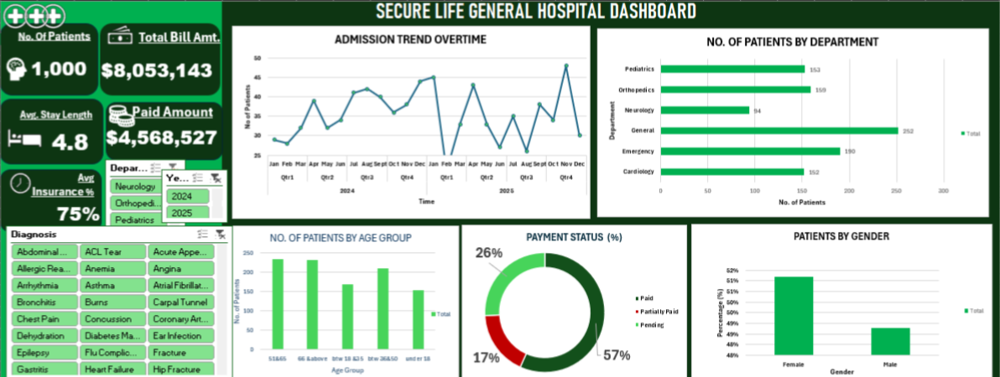

# SECURE LIFE GENERAL HOSPITAL

## INTRODUCTION 

The Secure Life General Hospital Performance Dashboard is a data analysis project I developed using Microsoft Excel to evaluate the hospital's operational and financial performance. The project focuses on patient visits, departmental performance, admission trends, medical billing, insurance coverage, and payment status.

My aim is to transform raw hospital data into meaningful insights through data analysis and visualization. The dashboard provides a clear overview of the hospital's activities and helps identify important trends that can support effective decision-making.

## ABOUT THE DATASET

The dataset contains patient visit records, including age, gender, admission and discharge dates, department, diagnosis, total bill amount, insurance coverage, and payment status.

I used these variables to analyse patient distribution, compare departmental performance, monitor billing and payments, and examine admission patterns over time. The dataset also supports the calculation of key performance indicators, such as average length of stay and insurance coverage.

## PROBLEM STATEMENT

The hospital needs a clear way to monitor patient admissions, departmental performance, medical bills, outstanding payments, and insurance coverage. I developed an interactive dashboard to present these metrics and support better management decisions.

## VISUALIZATION

The dashboard presents key performance indicators, charts, and interactive filters to explore patient visits, billing, admission trends, age groups, gender distribution, and payment status.

## INSIGHTS

- Total patient records: 1,000 visits
- Total bill amount: $8,053,143.
- Total paid amount: $4,568,527.
- Average length of stay: 4.8 days.
- Average insurance coverage: 75%.
- Departmental performance: General recorded the highest number of visits, with 252 patients.
- Payment status: 57% paid, 17% partially paid, and 26% pending.
- Gender distribution: Female patients accounted for approximately 51% of visits, while male patients accounted for about 49%.
- Admission trends: Patient visits fluctuated across the periods shown in the dashboard.
- Age Group Distribution: The dashboard shows differences in visit numbers across age groups, helping identify groups with higher hospital usage.
- These findings provide a useful overview of patient activity and the hospital's financial position. However, the exact outstanding balance and the causes of admission fluctuations require further analysis of the underlying data.

##  RECOMMENDATION FOR FURTHER ANALYSIS 

I recommend strengthening payment follow-ups, monitoring pending bills, reviewing departmental resource allocation, and tracking admission trends regularly. The hospital should also maintain accurate billing and insurance records to improve financial monitoring.

## Conclusion

This project demonstrates my ability to use Microsoft Excel to analyse hospital data and create an interactive dashboard. It highlights how data visualization can help identify performance trends and support informed operational and financial decisions.

